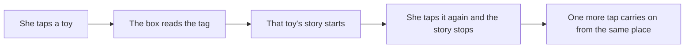
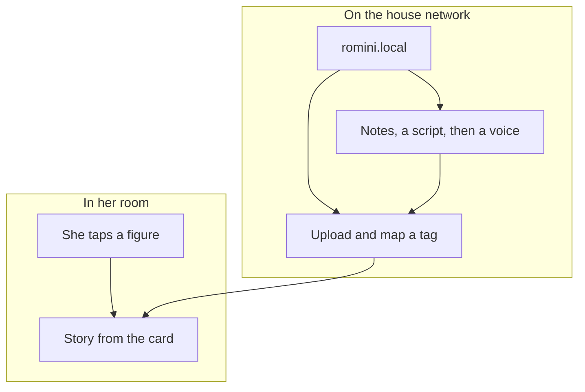
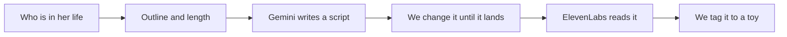

Bedtime still happens on the nights my wife and I are both working late. One of us is in the room. The other is stuck at the office. Romy, my daughter, gets only one voice during story time. I wanted her to hear the other one too, and I didn't want a screen in there to do it.

<!--more-->

[{:style="object-fit:contain;height:auto;max-height:none;min-height:0"}](/assets/2026-10-03-building-a-story-box-for-romy/box.webp)

## What it had to be

Something she would reach for. If I am the only person who enjoys it, it ends up in a drawer.

Her hands, not an app. Tap a thing, get a story. Tap it again, it stops. That is the whole interface. A tablet will play a story and then offer the next thing, with the light of the screen in a dark room. I don't want bedtime to be a negotiation with an app.

Objects she already has. A small NFC tag on a toy. A tag in a book. I didn't want a new gadget she has to learn, and I didn't want a special cartridge that only works with one company's stories.

Our voices, including the nights one of us is missing. We already read to her. The gap is the parent who is not in the room, so a book can be one of us, recorded, and played back from the tag in the cover.

The books are not the only stories worth hearing. If something happened today, she should get a story about that. About her, about us, about the house and the toys and whoever else is in the week. That one is more fun than a recording, and it is not either of our voices.

The box has to keep working when the house internet doesn't. Listening is a file on a card. The network is for us, later, when we add something.

## How she uses it

RoMini is a box. A Raspberry Pi, a speaker, an NFC reader and no screen. She never sees a menu.

She taps a tagged toy on the pad and the story for that toy starts. She taps it again and it stops. Tap once more and it carries on from the same place. Each toy keeps its own place, so two of them are not sharing one bookmark.

[{:style="max-height:500px"}](/assets/2026-10-03-building-a-story-box-for-romy/toy.webp)

A book works the same way. The tag is on the book. She taps the book on the box and hears one of us reading it.

The box has a charge port and a single button, and that button wakes the device and puts it to sleep with a welcome and goodbye chime. Loudness is ours to set from the dashboard.

[{:style="max-height:500px"}](/assets/2026-10-03-building-a-story-box-for-romy/side-button-and-usb-c.webp)

## What went in the box

The reader sits under a wooden lid. Wood is fine. A metal lid would block the tag. We have a bunch of different NFC tag styles: stickers, buttons and key rings. They are fixed to toys and books she already owns. The computer is a Raspberry Pi 4. Sound comes out of a powered speaker and an amp. A battery hat means the box can sit away from a socket, which matters when she wants to hold it. The card is partitioned, so a yanked plug is less likely to take the system down with the stories. Stories live on their own partition.

The parts list and the wiring notes are in the repo: [hardware](https://github.com/mzworthington/RoMini/blob/main/docs/hardware.md).

## On the bench

The box came together on the bench before it was a thing she could put a toy on. A Pi, the NFC reader, a speaker and a lot of wiring that does not belong in her room.

Most of the player was written before that wiring existed. On a laptop the same software pretends to be the box: fake reader, fake buttons, real library. I could paste a tag ID, check that a story starts, stops and remembers its place, and only then move those rules onto the Pi.

[{:style="object-fit:contain;height:auto;max-height:none"}](/assets/2026-10-03-building-a-story-box-for-romy/harness.webp)

## The wooden cube

The wiring needed a box she can hold. One sheet of 3 mm birch, cut as a 130 mm cube. The lid carries the mark as a shallow engraving, about 0.5 mm, so it does not cut through. The walls and the lid are glued. The bottom is not. Four screws into dowels in the corners let that panel come off when the Pi, the battery or the card needs a hand.

A shelf halfway up those dowels lifts the Pi toward the reader under the lid. The front is a grille. Behind it, a smaller plate has two openings for a pair of small enclosed speakers. Those are passive, so they still need an amp. The box she uses has a powered speaker.

[Cutting Edge CNC](https://cuttingedgecnc.co.uk/) laser-cut the birch. They turned the job around quickly and were straightforward to work with.

[{:style="max-height:500px"}](/assets/2026-10-03-building-a-story-box-for-romy/enclosure-three-quarter.webp)

[{:style="max-height:500px"}](/assets/2026-10-03-building-a-story-box-for-romy/lid-logo-closeup.webp)

The cut file, the shop letter and these renders are in the repo: [fabrication](https://github.com/mzworthington/RoMini/blob/main/docs/fabrication.md).

## The companion app

She never opens this. We do, on the house network, at `romini.local`. Upload a file, map a tag, set how loud it is, see what is actually on the pad without walking in.

### The live player

The live player is the one I open when I want to know if she is mid-story: which figure, how far through, and the volume cap. The cap is the point. Bedtime should not be able to creep up to the speaker's idea of loud.

[{:style="object-fit:contain;height:auto;max-height:none"}](/assets/2026-10-03-building-a-story-box-for-romy/player.webp)

### Figures and tags

The Figures and tags page lets me register a tag, give it a picture and point it at a story.

[{:style="object-fit:contain;height:auto;max-height:none"}](/assets/2026-10-03-building-a-story-box-for-romy/figures.webp)

### The library

The library is a folder with a form in front of it. Drop in an MP3, give it a title, point it at a figure. Unassigned files sit there until they have a toy. I can play a track back on the laptop before it is hers.

[{:style="object-fit:contain;height:auto;max-height:none"}](/assets/2026-10-03-building-a-story-box-for-romy/library.webp)

### The system page

Volume lives on the system page, next to whether a figure is on the plate. The keys for drafting and speaking a story are on this page too. Two activity streams sit on that page. One is the Pi's logs, for when something misbehaves. The other is the box's own record of what it did.

From the same page I can push an over-the-air update, reboot the box, switch play mode between presence and tap, or raise the volume cap.

[{:style="object-fit:contain;height:auto;max-height:none"}](/assets/2026-10-03-building-a-story-box-for-romy/settings.webp)

## A story about today

Recording ourselves is the book. Put the tag in the cover, read it once, and she can hear that parent again. I wanted another kind of track too. One we would not sit down and perform. A story that only exists because this week happened, told in a voice that is not mine and not my wife's, then stuck to a toy she already takes to bed. That part is the story studio.

We start with the people in her life. Each one is a name and a bit of background: who they are to her, how they behave, what she would recognise. Romy is in that list on purpose. So are we. So is anyone else who keeps turning up, toys included. Those notes stay on the box. The next story should not have to be told who lives in the house, or what is around her.

[{:style="object-fit:contain;height:auto;max-height:none"}](/assets/2026-10-03-building-a-story-box-for-romy/characters.webp)

The brief for one story is small. We tick who is in it. We write an outline, a few lines on what has to happen. We set how long it should be. That is the whole ask. Gemini writes the script from those notes and from the characters we have already described.

We read that script before anyone speaks it. This is the part that matters. The first draft is a start. We change the lines, the ending, the bit where she would lose the thread. Titles keep her name as Romy. In the script she is Rowmy, and we are Maama and Baaba, because that is how the stories are said aloud. Marks in square brackets, a pause or a whisper or a yawn, are instructions to the reading. They are not words for her to hear.

When the words are the ones we want, we send that script to ElevenLabs and pick a voice. It comes back as an MP3 on the box, the same kind of file as a book we recorded. We bind it to a figure. She taps that toy and gets a story about her, about us and about the place she is actually in. Next week we open the same notes, change the outline and do it again.

Making that story uses the network only when we ask: once for Gemini to draft, once for ElevenLabs to read.

[{:style="object-fit:contain;height:auto;max-height:none"}](/assets/2026-10-03-building-a-story-box-for-romy/stories.webp)

## If you want the build

The code is [on GitHub](https://github.com/mzworthington/RoMini). Start with the [parts and wiring](https://github.com/mzworthington/RoMini/blob/main/docs/hardware.md) if you are building a box, the [wooden cube](https://github.com/mzworthington/RoMini/blob/main/docs/fabrication.md) if you want the sheet [Cutting Edge CNC](https://cuttingedgecnc.co.uk/) laser-cut for us, or the [parent pages](https://github.com/mzworthington/RoMini/blob/main/docs/dashboard.md) if you want to see the screens without one. How the player is put together, including the laptop that pretends to be a Pi, is [the architecture note](https://github.com/mzworthington/RoMini/blob/main/docs/architecture.md).

She taps a thing she already loves on a wooden box, and she gets a story. Sometimes that is one of us, recorded. Sometimes it was written that afternoon, about her and the people around her, and a voice that is neither of ours reads it to her.

[{:style="object-fit:contain;height:auto;max-height:none"}](/assets/2026-10-03-building-a-story-box-for-romy/dashboard-tour.gif)